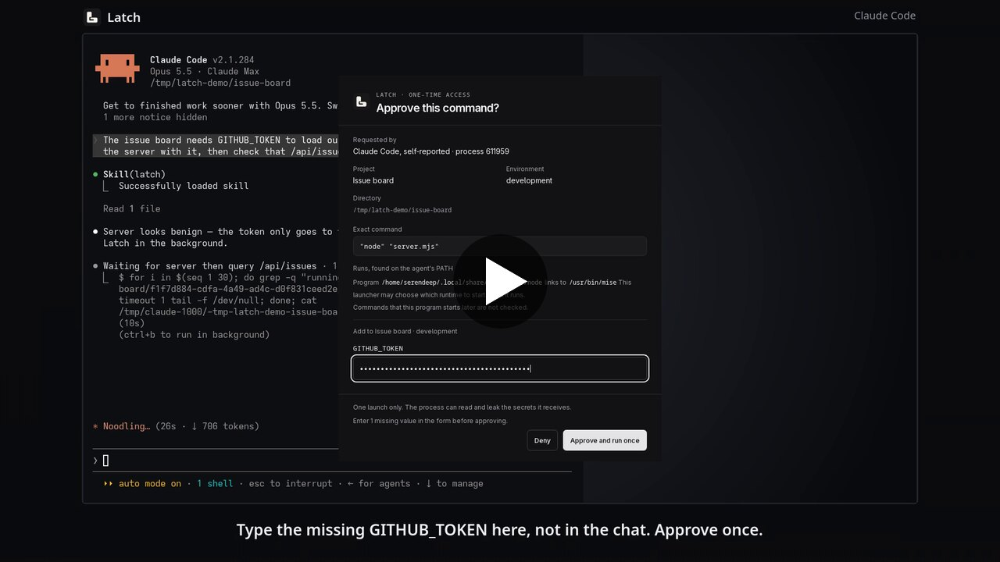
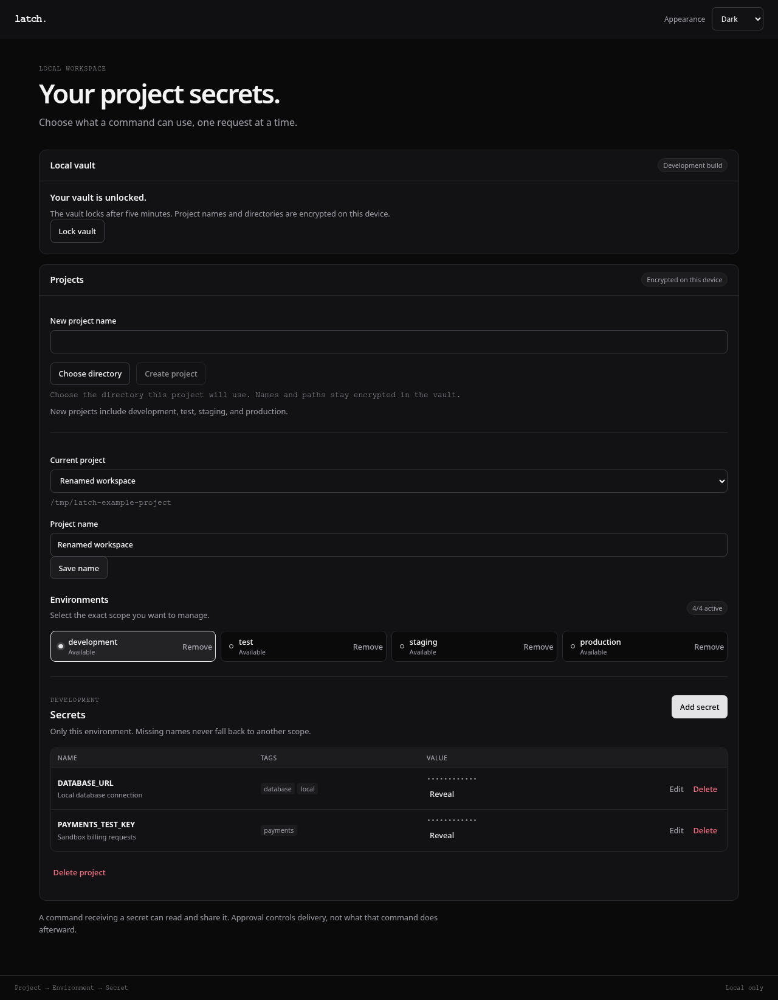
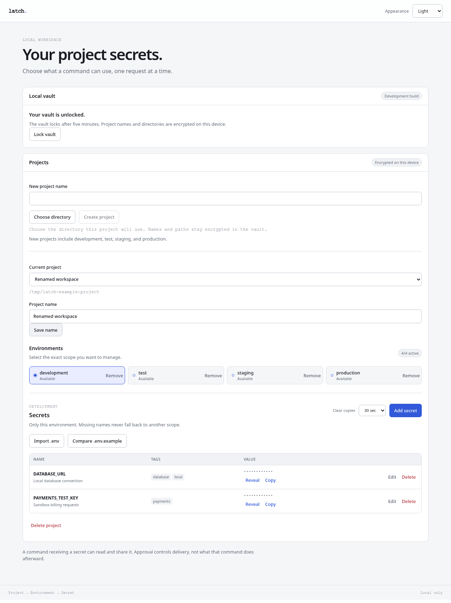

# Latch

[](https://github.com/Serendeep/latch/actions/workflows/checks.yml)
[](https://github.com/Serendeep/latch/actions/workflows/security.yml)
[](LICENSE)

Give a project command the secrets it needs without pasting them into your coding agent's conversation or another `.env` file.

When an agent needs a key, it asks Latch to launch a command with that named secret. A small desktop popup shows the project, environment, and exact command. You can enter a missing value, approve one launch, or deny the request. The main app stays in the tray until you need to manage your vault.

Latch is open source and local only. It uses Tauri 2, React, TypeScript, Rust, and SQLite.

## Watch it work

[](docs/assets/latch-demo.mp4)

[Watch the demo (1:52)](docs/assets/latch-demo.mp4). It shows, in one take:

1. Creating a vault and adding a project.
2. Claude Code asking to start a dashboard that needs `GITHUB_TOKEN`. The key is typed into the Latch popup and approved for one launch.
3. Codex running a new script with the same stored key.
4. The audit history of both requests.

Both are the real agent apps, running in a disposable Linux session with its own keyring and vault. The dashboard talks to a local mock of the GitHub API, and the token is generated for the recording. Slow stretches are sped up and labeled.

## Install

Latch runs on Linux (x86_64) and stores its device key in the GNOME Keyring. You need `gnome-keyring` running with a password-protected login keyring, which GNOME sets up by default. Other desktops work when they start `gnome-keyring-daemon`.

Download a package from the [latest release](https://github.com/Serendeep/latch/releases/latest) and check it against `SHA256SUMS`:

```sh
sudo apt install ./Latch_*_amd64.deb      # Debian, Ubuntu
sudo dnf install ./Latch-*.x86_64.rpm     # Fedora
```

Both packages install the desktop app and the `latch` CLI. On other distributions, use the AppImage and put `latch-linux-x86_64` on your `PATH` as `latch`. See [getting started](https://latch.serendeep.tech/docs/getting-started) for details and for building from source.

Then install the agent skill:

```sh
pnpm dlx skills add Serendeep/latch --skill latch --global
```

The installer detects Codex, Claude Code, and other compatible agents. Start a new agent session afterwards. You can [review the complete skill](integrations/latch/SKILL.md) first. Codex on Linux needs one sandbox setting; see [coding agents](https://latch.serendeep.tech/docs/agents).

## What you get

- Secrets organized by project and environment (development, test, staging, production).
- Import from `.env`, and a comparison against `.env.example`.
- Reveal one value deliberately, or copy it with timed clipboard clearing.
- Agent requests that show the exact command and the files it resolves to. You approve one launch, and you can add a missing value in the same popup.
- Quitting Latch stops every command it launched.
- Metadata-only audit history of vault operations, requests, decisions, injections, and process exits. It never records values, commands, or executable paths.
- Encrypted backups. Export every project and secret to one password-protected file, and restore it into a vault on another machine.

## Current status

Latch is early software for Linux. macOS and Windows build in CI, but their credential-store adapters and command transport are not ready. Releases are not signed yet, and there is no automatic updater.

Approval controls which process receives a secret. **That process can read and leak it.** Latch does not sandbox approved commands. Latch has not had an external security review. Read the [security model](https://latch.serendeep.tech/docs/security) before storing production credentials, and keep an encrypted backup.

## The app



<details>
<summary>Light mode</summary>



</details>

These UI previews use sample metadata and concealed values. Latch supports system, light, and dark appearance, with native title bars that follow the desktop theme.

## Documentation

Read the [documentation](https://latch.serendeep.tech/) for setup, agent integration, vault management and backups, and the security model. The guides live alongside the code and are published with GitHub Pages.

## Contributing

See [CONTRIBUTING.md](CONTRIBUTING.md) for setup, checks, and contribution requirements, and [CHANGELOG.md](CHANGELOG.md) for changes. The [example configuration](examples/latch.example.toml) contains names only and is not loaded by the app.

## Support

If you want to support continued development, you can [buy me a coffee](https://buymeacoffee.com/serendeep).

## License

[MIT](LICENSE).
